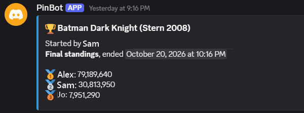
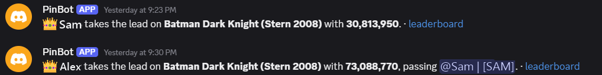

# PinBot

Automated virtual pinball high-score competitions for your Discord community.

Turn on your VPin and play. If a competition is running on that game, your score appears on the Discord leaderboard:
PinBot reads the high scores from the game itself and matches your initials to your server nickname.

- **Joining:** nobody signs up. Your initials in your server nickname, e.g. `Name | [ABC]`, are enough.
- **Scores:** read from the game after each play. No screenshots, no forms.
- **Setup:** paste one line on the VPin. PinBot finds Visual Pinball X and your tables by itself.
- **Updates:** the PinBot server and every VPin install new signed releases by themselves. Nothing to maintain.

Your own high scores are backed up before a competition and put back exactly as they were after it
([how](docs/NVRAM-SAFETY.md)). PinBot uses about 20 MB of memory and sleeps while a table runs.

## Join a competition (VPin owners)

1. In your Discord server, run `/pinbot pair`. Only you see the reply: a link to download `pinbot.exe` and a one-time
   pairing line.
2. Run `pinbot.exe` on your VPin. If Windows warns about it (*unknown publisher* or *Windows protected your PC*), choose
   **More info → Run anyway**.
3. Paste the line and press Enter. PinBot installs itself and starts with Windows.
4. Put your initials in your server nickname, e.g. `Name | [ABC]`, and enter them on the machine when you get a high
   score.

More: [On your VPin](docs/VPIN.md) (troubleshooting, uninstalling) and [How competitions work](docs/PLAYING.md).

## Set up PinBot for your Discord server (admins)

About 45 minutes, once:

1. [Run the PinBot server](docs/DEPLOY-NAS.md) on a Synology NAS or any always-on Docker host.
2. [Connect it to Discord](docs/DISCORD-SETUP.md): create the Discord app and choose PinBot's channels.
3. Invite your members to run `/pinbot pair`.

## Requirements and limits

- **VPin:** Windows 10 or 11 with Visual Pinball X. Only ROM-based (PinMAME) tables whose ROM has a memory map; original
  and EM tables can't be used. A game counts once you exit the table.
- **Server:** an always-on Docker host (a Synology NAS guide is included) and a free Tailscale account, which gives it a
  public HTTPS address without opening router ports.
- **Discord:** *Manage Server* rights on your Discord server, for the setup.
- **Trust:** scores are read on each owner's own PC, so PinBot is for friendly communities, not prize tournaments.

## Commands

| Command | What it does |
|---|---|
| `/pinbot start` | Start a challenge on a game, from 1 hour to 7 days |
| `/pinbot status` | What's running, who leads, and each VPin |
| `/pinbot games` | Every game you can start a challenge on |
| `/pinbot end` | End a challenge you started |
| `/pinbot guest` | Let a friend without Discord score with their own initials for 24 hours |
| `/pinbot pair` | Connect your VPin |
| `/pinbot help` | How PinBot works |
| `/pinbot-admin weekly` | Server managers: the automatic weekly competition |
| `/pinbot-admin channels` | Server managers: where PinBot posts |

## Documentation

- **Players:** [On your VPin](docs/VPIN.md), [How competitions work](docs/PLAYING.md),
  [How your high scores are kept safe](docs/NVRAM-SAFETY.md)
- **Admins:** [Run the PinBot server](docs/DEPLOY-NAS.md), [Connect it to Discord](docs/DISCORD-SETUP.md),
  [Security](SECURITY.md)
- **Developers:** [Development](docs/DEVELOPMENT.md), [Server reference](docs/SERVER.md),
  [How releases are signed](docs/CODE-SIGNING.md)

## Release signing

Every release is built here by GitHub Actions and signed with the project's release key; servers and VPins install an
update only when its signature matches. `pinbot.exe` is not signed with a Windows code-signing certificate, which is why
Windows warns the first time you run it. It sends data only to the PinBot server it was paired with. Details:
[CODE-SIGNING.md](docs/CODE-SIGNING.md).

## Development

Requires Windows and the .NET 10 SDK; the server tests also need PostgreSQL. See [DEVELOPMENT.md](docs/DEVELOPMENT.md).
Issues and pull requests are welcome.

## License

MIT. Game memory maps from [Pinball Memory Maps](https://github.com/tomlogic/pinball-memory-maps) (ODbL);
see [NOTICE.md](NOTICE.md).
