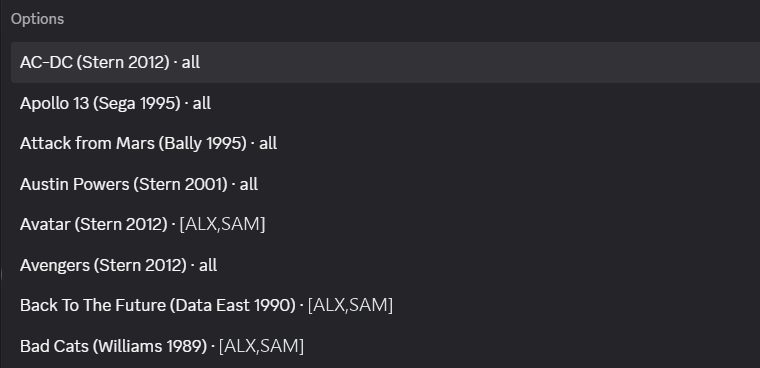

# How competitions work

For players: what PinBot posts in Discord and which games count. To connect your own VPin, see [VPIN.md](VPIN.md).

## Your initials

Put your initials in your **server nickname**, e.g. `Name | [ABC]` (more than one: `Name | [ABC,XYZ]`), and enter them
on the machine when you get a high score. Nobody registers or joins a competition; PinBot matches the initials to you.

- Initials that two members both use count for neither (PinBot can't tell who played). Both get a private message as
  soon as PinBot notices, so one of you can change.
- A score entered before you added the initials to your nickname still counts once you add them, as long as the
  competition hasn't finished. PinBot reads nicknames every 10 minutes.
- Playing with a friend who isn't on Discord? `/pinbot guest initials:XYZ` makes scores entered as XYZ count for your
  guest for 24 hours (run it again to extend), including games they already played. You can host up to 5 guests.

## Challenges and the weekly competition

- **Challenges:** any member starts one with `/pinbot start`, on any game a connected VPin has, from 1 hour to 7 days
  (3 days if you don't choose). You can have 2 of your own running at a time. `/pinbot end` ends one you started; games
  already finished still count.
- **Weekly:** if a server manager turned it on, a new game starts every week at the same time, chosen from the games
  every VPin has where possible.
- One game can only have one competition at a time.

Pick the game by typing part of its name. The list shows every game a connected VPin has, and which players' VPins have
it (`all` means every VPin):

## What PinBot posts

- **The leaderboard card**, in the challenges (or weekly) channel, pinned while the competition runs. It shows the
  standings, every participant, and which VPins are ready:
  - 🟢 **Ready on**: the competition's high-score table is in place on that VPin.
  - ⏳ **Getting ready**: for example, that table is being played right now.
  - ⚠️ **Can't run on**: that VPin can't take part in this one; its owner can run `pinbot status` to see why.
- **📣 New challenge / New weekly competition**: when one starts. Nobody is pinged.
- **👑 … takes the lead** (a new leader), **👑 … raises the top score** (the leader beats their own best), and
  **⚡ … takes 2nd place** (any better place). Only the members just overtaken are pinged; PinBot never uses
  @everyone, @here or roles.
- **⏰ ends in 10 minutes**: time for one more game (not for competitions shorter than 30 minutes).
- **🏁 … has ended!**: the final podium, pinging the top three.

Every message about a competition has a **leaderboard** link that jumps to its card.

## Which games count

- A game counts if you **exit the table before the deadline**. Your best score counts.
- Its result must reach the PinBot server within 5 minutes of the deadline (normally it takes seconds). Then the
  standings are final: a VPin that is offline at the deadline loses its last games.
- A game started before a VPin was ready still counts if it beats that table's own high scores.
- Each ROM revision is its own game: two VPins compete together only on the same ROM. `/pinbot games` shows each.
- Scores are read from each owner's own PC, so PinBot is meant for friendly communities.

## My score didn't show up

1. Are your initials in your **server nickname** (`Name | [ABC]`), and did you enter exactly those on the machine?
2. Did you **exit the table** before the deadline? A game still running at the deadline doesn't count.
3. Is the table supported? On the VPin, `pinbot scan` lists each table and whether it can be used.
4. Was the VPin **online** within 5 minutes of the deadline? `/pinbot status` shows each VPin.
5. Still missing? Run `pinbot report` on the VPin and attach the zip to a
   [bug report](https://github.com/skylerkingdev/PinBot/issues/new/choose), or give it to your server's admin.
